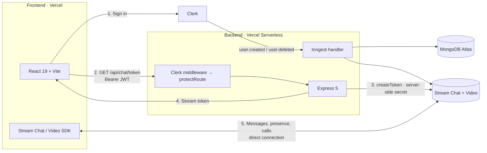

<div align="center">


# Syncly

**Real-time team messaging and video calling — Slack-style channels, DMs, and one-tap calls.**

Built on an event-driven Node backend with serverless-safe Express, Clerk-issued JWTs, and Stream's Chat/Video infrastructure.

[](https://react.dev)
[](https://vite.dev)
[](https://nodejs.org)
[](https://expressjs.com)
[](https://mongodb.com)
[](https://vercel.com)

<!-- TODO: Add live demo + walkthrough once deployment URLs are confirmed public -->
<!-- [**Live Demo**](TODO) · [**Video Walkthrough**](TODO) -->

</div>

---

## Contents

- [What it does](#what-it-does)
- [Architecture](#architecture)
- [Engineering decisions](#engineering-decisions)
- [Tech stack](#tech-stack)
- [Local development](#local-development)
- [Configuration](#configuration)
- [API surface](#api-surface)
- [Async jobs](#async-jobs)
- [Deployment](#deployment)
- [Project structure](#project-structure)
- [License](#license)

---

## What it does

Syncly is a full-stack workspace chat app. Users sign in with Clerk, land in every public channel automatically, and can create channels, DM teammates, pin messages, invite members to private rooms, and jump into a video call from any channel.

| Capability | Implementation |
| --- | --- |
| **Auth** | Clerk-hosted sign-in/sign-up. A React `AuthProvider` installs an Axios request interceptor that attaches the Clerk JWT as a `Bearer` token on every API call. |
| **Channels** | Public (`discoverable: true`) and private (`private: true`) channels. Channel IDs are slugified from the display name and capped at 20 chars. |
| **Direct messages** | Rendered from the same Stream channel list, separated from channels by a member-count + Clerk-ID-prefix heuristic. |
| **Video calls** | Stream Video SDK with `SpeakerLayout` + `CallControls`. Starting a call posts a joinable `/call/:id` link into the channel, so the call is discoverable to everyone in the room. |
| **Presence & unread** | Stream-managed presence via `options: { presence: true }` on the channel list; unread counts from `channel.countUnread()`. |
| **User provisioning** | Clerk lifecycle webhooks fan out through Inngest to Mongo + Stream (see [Async jobs](#async-jobs)). |
| **Observability** | Sentry on both runtimes, with React Router v7 browser tracing and Express error capture. Stream connection failures are tagged and reported manually. |

<!-- TODO: Add 2-3 screenshots or a short GIF (channel view, call view, create-channel modal).
     Recruiters spend <30s on a README — visuals do more work than prose. -->

---

## Architecture

Two independently deployed apps. The backend is deliberately thin: it never proxies messages. It issues short-lived Stream tokens and lets the client talk to Stream directly, so chat traffic never passes through — or is bottlenecked by — the Express layer.



### Token exchange

The `STREAM_API_SECRET` never reaches the browser. The client authenticates to Clerk, exchanges that JWT for a Stream token at `/api/chat/token`, and uses it to open its own realtime connection.

```
Clerk session JWT  →  clerkMiddleware()  →  protectRoute()  →  streamClient.createToken(userId)  →  client
```

---

## Engineering decisions

Choices worth calling out, and why they were made:

**Serverless-safe Express.** `app.listen()` is guarded behind `NODE_ENV !== "production"` and the app is exported as the module default, so the same entry point runs under `nodemon` locally and as a Vercel serverless function in production without a separate handler file.

**Database connection inside each job.** Inngest functions call `connectDB()` at the top of every invocation rather than relying on module-level state, because serverless cold starts give no guarantee that a prior connection survived.

**Direct client↔Stream connection.** Routing messages through Express would add latency, cost, and a scaling bottleneck for zero benefit. The backend's only job in the chat path is minting a token.

**Webhooks handled asynchronously.** Clerk's `user.created` triggers three side effects (Mongo insert, Stream upsert, public-channel backfill). Running these through Inngest rather than a synchronous webhook handler means Clerk gets a fast ack and the work is retried on failure instead of silently lost.

**Instrumentation loaded before the app.** Sentry is imported via `--import ./instrument.mjs` so its auto-instrumentation patches modules before Express and Mongoose are required — the ordering most Sentry/Node setups get wrong.

---

## Tech stack

**Frontend** — React 19 · Vite 7 · TailwindCSS 4 · React Router 7 · TanStack Query 5 · Clerk React · Stream Chat React 13 · Stream Video React SDK · Sentry React · Axios · Lucide

**Backend** — Node.js ≥18 (ESM) · Express 5 · Mongoose 8 / MongoDB · Clerk Express · Stream Chat 8 · Inngest 3 · Sentry Node

---

## Local development

**Prerequisites:** Node ≥ 18, plus accounts for [Clerk](https://clerk.com), [Stream](https://getstream.io), [MongoDB](https://mongodb.com), and optionally [Sentry](https://sentry.io) and [Inngest](https://inngest.com).

```bash
git clone https://github.com/sivasankar55/Syncly.git
cd Syncly

# Terminal 1 — API on :5001
cd backend && npm install && npm run dev

# Terminal 2 — app on :5173
cd frontend && npm install && npm run dev
```

Open <http://localhost:5173>.

| | Backend | Frontend |
| --- | --- | --- |
| Dev | `npm run dev` (nodemon + Sentry) | `npm run dev` |
| Build | — | `npm run build` |
| Preview | `npm start` | `npm run preview` |
| Lint | <!-- TODO: no linter configured --> — | `npm run lint` |

<!-- TODO: No test suite or CI pipeline exists yet. This is the single highest-value
     addition for engineering credibility — even a handful of integration tests on
     the token endpoint plus a GitHub Actions lint/build workflow. -->

---

## Configuration

Both apps read from a local `.env`. Neither file is committed.

<details>
<summary><strong>backend/.env</strong></summary>

```env
PORT=5001
NODE_ENV=development
MONGO_URI=mongodb+srv://...

CLERK_PUBLISHABLE_KEY=pk_...
CLERK_SECRET_KEY=sk_...

STREAM_API_KEY=...
STREAM_API_SECRET=...

INNGEST_EVENT_KEY=...
INNGEST_SIGNING_KEY=signkey-...

SENTRY_DSN=https://...@sentry.io/...

# Single origin. Passed directly to the cors() middleware.
CLIENT_URL=http://localhost:5173
```

</details>

<details>
<summary><strong>frontend/.env</strong></summary>

```env
VITE_CLERK_PUBLISHABLE_KEY=pk_...
VITE_STREAM_API_KEY=...
VITE_API_BASE_URL=http://localhost:5001/api
VITE_SENTRY_DSN=https://...@sentry.io/...
```

</details>

> `CLIENT_URL` accepts **one** origin — it is handed straight to `cors({ origin })`. Multi-origin support was implemented and then reverted (`33a8e3e`); deployed environments set this to the production frontend URL.

<!-- TODO: Commit `.env.example` files for both apps so contributors get the schema
     without a README round-trip. -->

---

## API surface

| Method | Endpoint | Auth | Description |
| --- | --- | --- | --- |
| `GET` | `/api/chat/token` | Clerk JWT | Mints a Stream token scoped to the authenticated user. |
| `GET`/`POST`/`PUT` | `/api/inngest` | Inngest signature | Serves registered Inngest functions. |
| `GET` | `/` | Public | Liveness probe. <!-- TODO: returns "Hello World" — return `{ status, uptime }` and verify the DB connection instead. --> |
| `GET` | `/debug-sentry` | Public | Throws deliberately to verify Sentry wiring. <!-- TODO: guard behind NODE_ENV !== production or delete before a real launch. --> |

---

## Async jobs

Clerk lifecycle events are delivered to Inngest, which runs them with automatic retries.

| Event | Function | Effect |
| --- | --- | --- |
| `clerk/user.created` | `sync-user` | Inserts the user into MongoDB, upserts them into Stream, and adds them to every channel marked `discoverable: true`. |
| `clerk/user.deleted` | `delete-user-from-db` | Deletes the Mongo record and the Stream user. |

Point your Clerk webhook endpoint at `https://<your-api-host>/api/inngest`.

---

## Deployment

Both apps deploy to Vercel as **separate projects** rooted at `backend/` and `frontend/`.

- **Backend** — `backend/vercel.json` builds `src/server.js` with `@vercel/node` and routes all traffic to it. `NODE_ENV=production` is set at build time, which is what suppresses `app.listen()`.
- **Frontend** — `frontend/vercel.json` rewrites every path to `/` so React Router owns client-side navigation on deep links and refreshes.

After deploying, set `CLIENT_URL` on the backend to the frontend's production origin and `VITE_API_BASE_URL` on the frontend to the backend's `/api` origin.


## Project structure

```
Syncly/
├── backend/
│   ├── src/
│   │   ├── config/          # env, db, stream, inngest
│   │   ├── controllers/     # chat.controller.js
│   │   ├── middleware/      # protectRoute
│   │   ├── models/          # user.model.js
│   │   ├── routes/          # chat.route.js
│   │   └── server.js        # app entry, exported for serverless
│   ├── instrument.mjs       # Sentry, loaded via --import
│   └── vercel.json
└── frontend/
    ├── public/
    └── src/
        ├── components/      # modals, channel header/preview, user list
        ├── hooks/           # useStreamChat — token fetch + client lifecycle
        ├── lib/             # axios instance, API calls
        ├── pages/           # AuthPage, HomePage, CallPage
        ├── providers/       # AuthProvider — JWT interceptor
        └── styles/          # Stream Chat theme overrides
```

---

